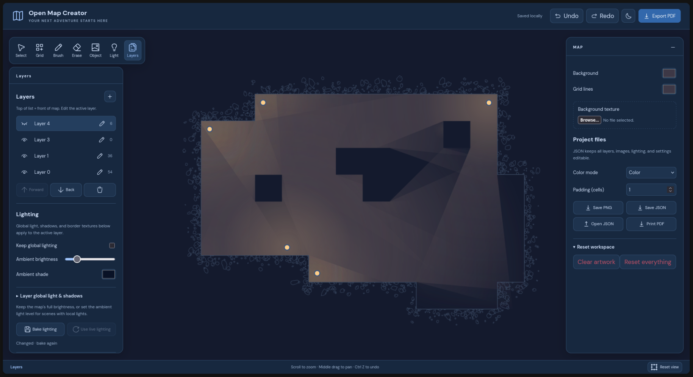
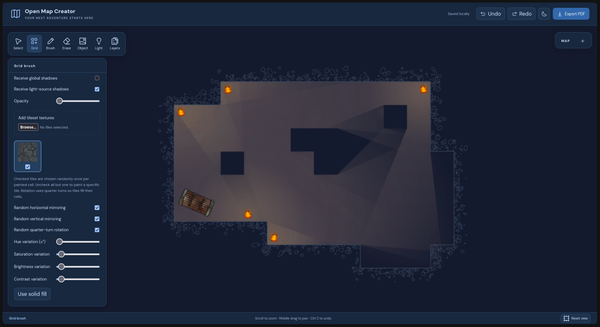
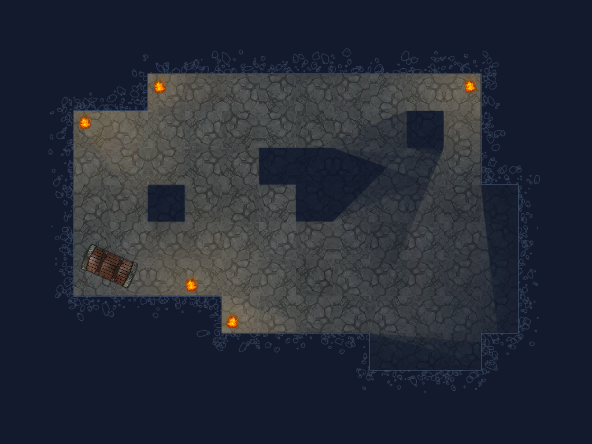
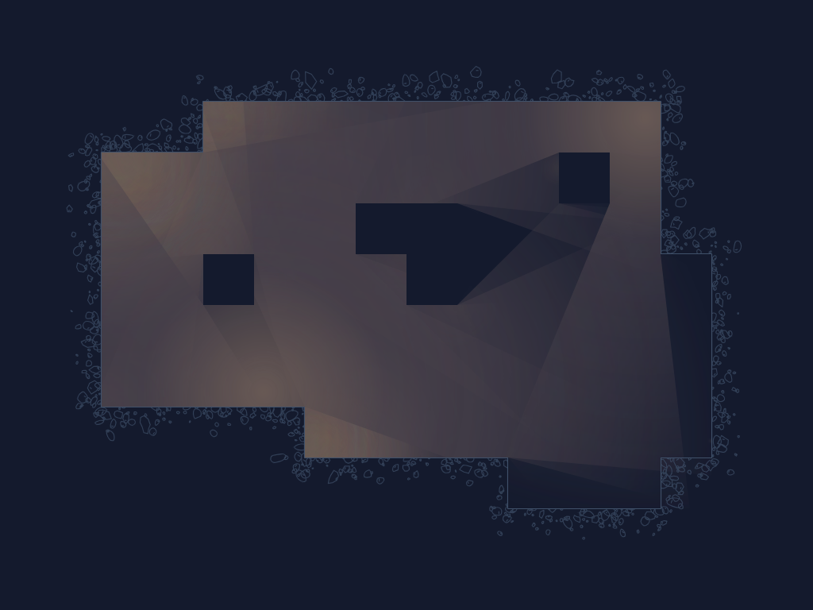
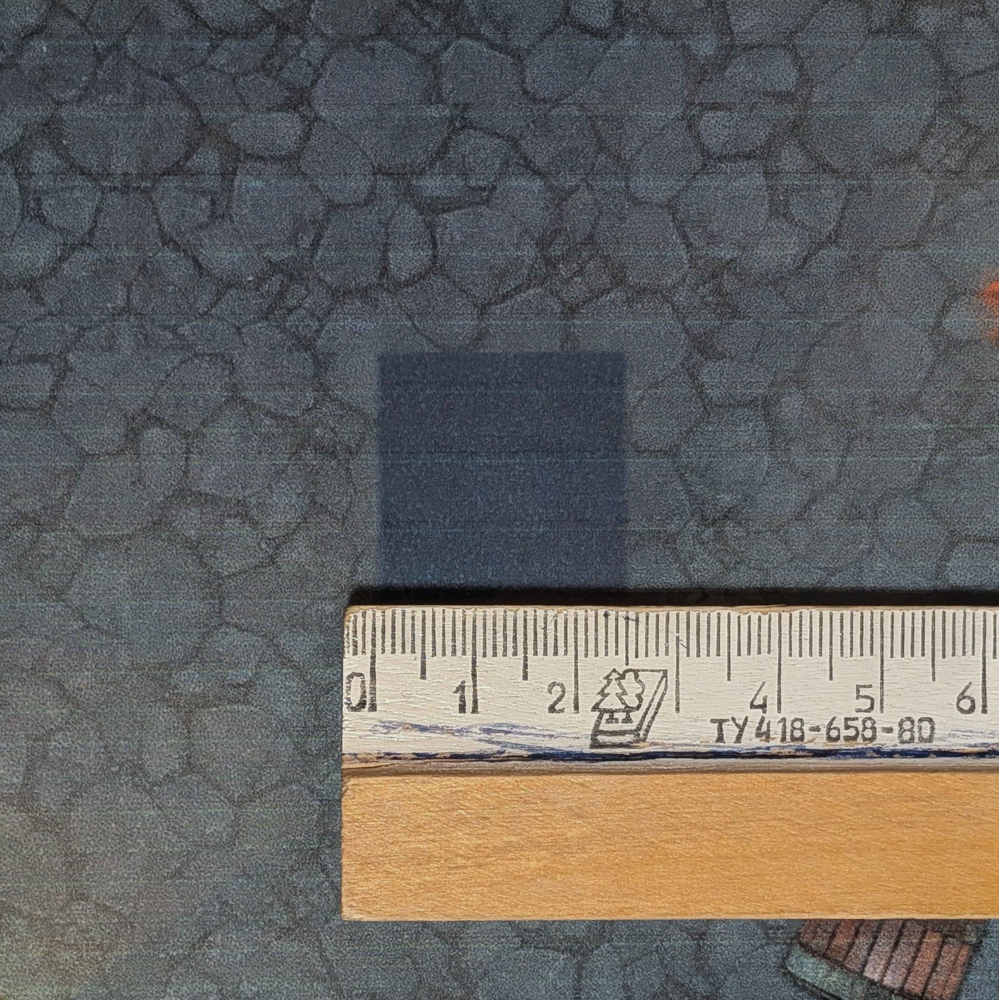
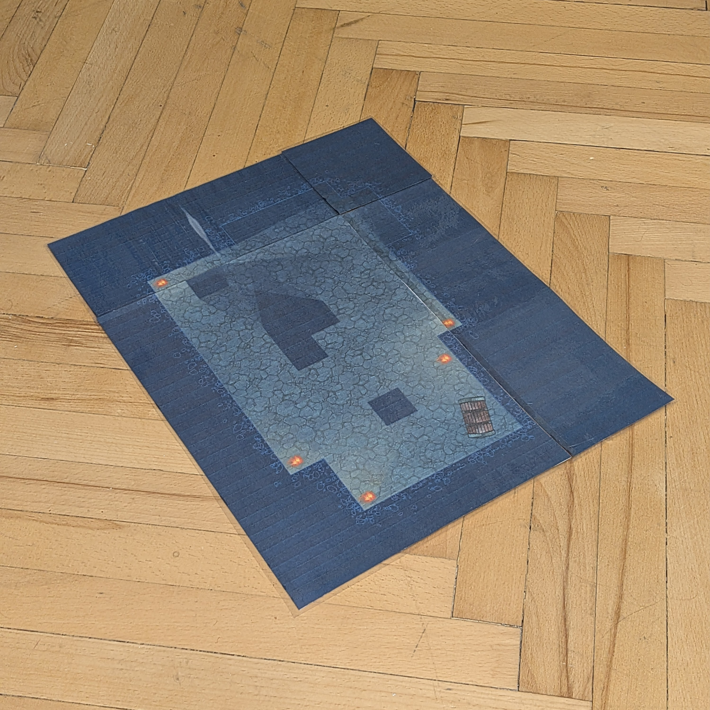

# Open Map Creator

[](LICENCE)
[](https://github.com/Rokoel/Open-Map-Creator/releases/tag/v2.0.0)

A browser map editor for tabletop RPGs. Draw dungeons, add textures and objects, place lights, and export a map for a virtual tabletop or print it across several sheets at the cell size you choose.

**[Open the app](https://rokoel.github.io/Open-Map-Creator/)** · **[Release notes](RELEASE_NOTES.md)** · **[Example PDF](docs/examples/open-map-creator-example.pdf)**



<a id="polygons-touch-controls-and-export-framing"></a>

## Drawing and editing

Use grid cells, freehand brushes, or polygons to draw a map. Cells and polygons can have uploaded textures; tilesets and brushes support random texture, rotation, size, and color variations.

Upload PNG, JPEG, or SVG objects to the Object menu, then choose a saved thumbnail to place it again. The uploaded library is saved with the project. Select placed objects to move, resize, rotate, mirror, or group them. Group resize handles and size fields scale members and their spacing together, preserving proportions. Arrow keys move the selection one cell; Shift+Arrow moves it ten cells. You can reorder layers, hide them, and move objects between them. Opening Layers or changing layers keeps the current drawing tool active.

Lights cast shadows from blocking objects. Each layer has its own lighting and border settings, including procedural borders or custom edge and corner images. Bake lighting to cache it for faster navigation and export.

To draw a polygon, choose **Polygon** (`P`) and click or tap its vertices. Click the first vertex, press Enter, or use **Finish polygon** to close it. **Remove last vertex** corrects a point; **Cancel** or Escape discards the draft. Select a finished polygon to edit its texture and appearance.

On a phone or tablet, draw with one finger and pan or pinch to zoom with two. The **Pan** tool also moves the map with one finger. Tap **Map** or the tool inspector's title to expand or collapse its settings.

## Controls

| Shortcut | Action |
| --- | --- |
| V / G / B | Select / Grid / Brush |
| Right mouse click / drag | Erase objects on the active visible layer |
| O / L / K | Image object / Light / Layers |
| P / H | Polygon / Pan |
| Enter (Polygon tool) | Finish polygon |
| Middle mouse drag / scroll | Pan / zoom |
| Two-finger drag / pinch | Touch pan / zoom |
| Shift-drag (Select tool) | Add to selection |
| Arrow keys / Shift+Arrow | Move selection one / ten cells |
| Ctrl/Cmd+Z / Ctrl/Cmd+Shift+Z | Undo / redo |
| Ctrl/Cmd+C / Ctrl/Cmd+V | Copy / paste |
| Ctrl/Cmd+G / Ctrl/Cmd+Shift+G | Group / ungroup |
| Delete or Backspace / Escape | Delete selection / deselect |
| Alt+scroll or [ / ] (Brush tool) | Change brush size |

## Saving and export

The app autosaves in your browser using IndexedDB. Use **Save JSON** to keep a separate editable copy of your project, and **Open JSON** to load one.

- **PNG** saves the map as a single image.
- **PDF** splits the map across A4 or A3 sheets. Set the orientation, physical cell size, resolution, and sheet margins before downloading. The default resolution is **300 DPI**; existing projects keep their saved resolution.
- **Export for VTT** saves JPG, PNG, WebP, or Universal VTT files with a chosen number of pixels per cell.

PNG and PDF exports also offer color, grayscale, and black-and-white output.

### Export area

In **Map → Export area**, click **Edit export area**. Drag inside the frame to move it, drag a corner to resize it, or enter its position and size in cells. Click **Finish editing area** to return to drawing. The frame is saved with the project and applies to PNG and PDF exports; VTT exports use it as their starting area.

**Fit area to artwork** removes the custom frame and restores automatic bounds around the artwork, including shadows and **Padding (cells)**. Padding only affects automatic bounds.

The dashed lines show PDF page breaks. **PDF page guides** and the PDF dialog share paper, orientation, cell size, DPI, and margin settings. Changes stay in sync between both places, including after undo/redo and resets. **Reset everything** restores 300 DPI and 5 mm sheet margins.

## Printing on sheets with margins

Set **Cell size (cm)** to the size you want on paper. In the PDF dialog, **Margins on every sheet (mm)** reserves blank space at the top, right, bottom, and left of each sheet. The default is **5 mm per edge**. Adjust these values to your printer's printable area; use 0 only if it supports borderless printing.

| Setting | Effect |
| --- | --- |
| **Padding (cells)** | Adds space around the complete map when using automatic bounds. |
| **Sheet margins (mm)** | Reserves paper on each sheet. Larger margins can add pages without shrinking cells. |
| **Print-app scaling** | Resizes the finished PDF when printing. Use Actual size / 100% to keep the chosen cell size. |

For example, A4 portrait with 5 mm margins leaves a 200 × 287 mm printable area. The exporter tiles the map to fit that space, and the page guides show the same split.

Print at **Actual size / 100%**, with **Fit to page** and **Shrink to fit** disabled. Trim the white edges and join the sheets. Sheet margins do not affect PNG or VTT exports.

## Virtual tabletop exports

Open **Map → Export for VTT**, choose a target and format, and download the file.

| Preset | Default output |
| --- | --- |
| D&D Beyond Maps | JPG at 100 pixels per cell |
| Roll20 | Universal VTT (`.uvtt`) at 70 pixels per cell |

For an image export, upload the file to your VTT and use the cell dimensions shown in the export dialog and filename to set its size. Configure walls and lights in the VTT separately. A Universal VTT file includes the background, grid scale, and any enabled wall and light data; import support depends on the VTT.

**Include grid lines** defaults off so the VTT can draw its own grid. **Align frame to whole cells** expands the export area outward without moving artwork. Universal VTT always uses whole cells; exact image frames report the pixel offset for grid alignment.

For dynamic lighting, leave **Include editor lighting in image** off. Turning it on bakes the lighting into the background and omits light sources from the UVTT data. Walls follow visible cells, polygons, and image rectangles with **Blocks light** enabled. Layers are flattened, and the editor's per-layer lighting and light rebounds are not reproduced by UVTT. Check the imported walls and lights before using the map.

The **File budget** limits download size; 0 disables it. JPG and WebP quality can be reduced to fit the budget while keeping the chosen pixels per cell.

<a id="gallery"></a>
<a id="gallery-and-example-downloads"></a>

## Examples



| Textured map | Lighting version |
| --- | --- |
| [](docs/media/map-textured.png) | [](docs/media/map-lighting-only.png) |

| Printed 2.5 cm cell | Map assembled from four sheets |
| --- | --- |
| [](docs/media/printed-cell-2-5cm.jpg) | [](docs/media/printed-map-four-sheets.jpg) |

Download the [four-page example PDF](docs/examples/open-map-creator-example.pdf).

## Run locally

There is no build step. Serve the repository over HTTP so its JavaScript modules load:

```bash
git clone https://github.com/Rokoel/Open-Map-Creator.git
cd Open-Map-Creator
python3 -m http.server 8000
```

Open **http://localhost:8000**. PDF export loads jsPDF from a CDN; the interface font comes from Google Fonts and falls back to a system font if unavailable.

## Contributing

See [CONTRIBUTING.MD](CONTRIBUTING.MD) for local setup, browser tests, and pull requests. Bugs and feature requests go in [Issues](https://github.com/Rokoel/Open-Map-Creator/issues).

Open Map Creator uses the [MIT license](LICENCE). Third-party libraries and assets are listed in [CREDITS.md](CREDITS.md).
